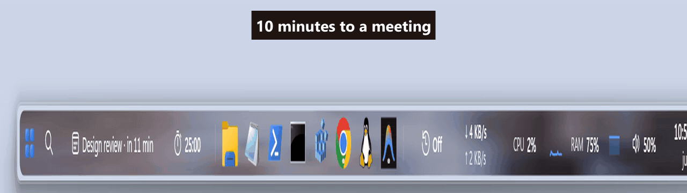
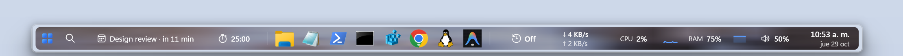
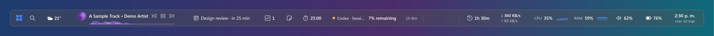
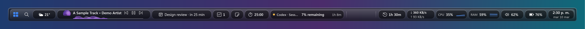
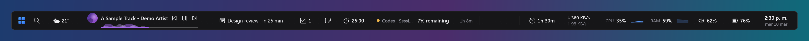
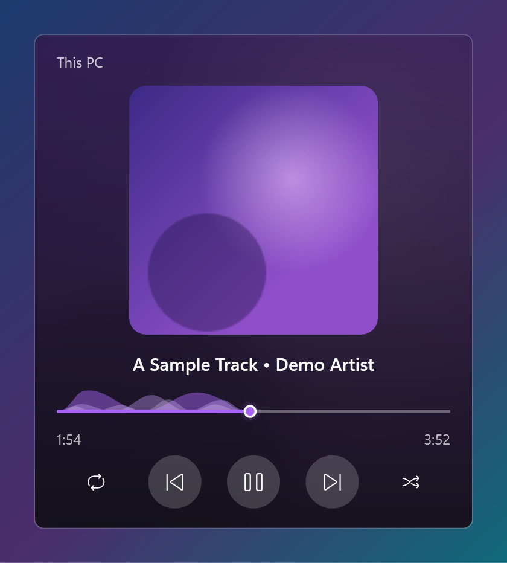
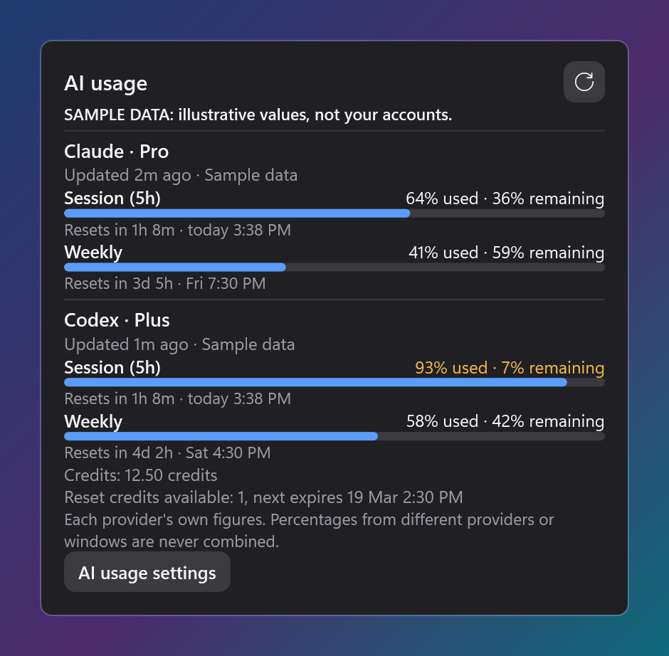
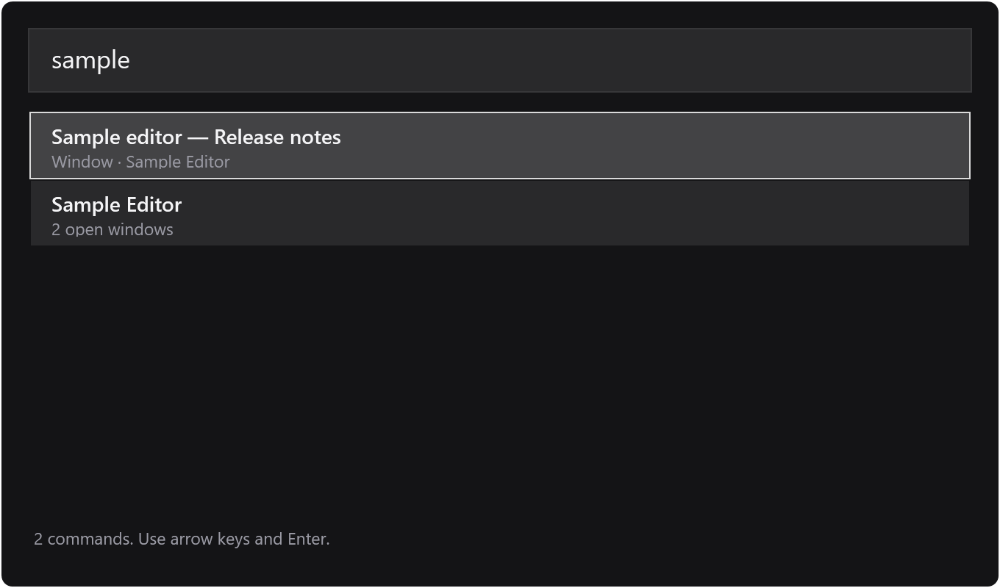

<picture>
  
</picture>

# LucentDock

**A smart dock for Windows that rearranges itself when something needs you** — for people whose day
is meetings, timers and limits, not just a row of app icons. Version 1.3.2.¹

**[Download](https://github.com/LeonelIvanCortesRodriguez/LucentDock/releases)** ·
[Watch the story (≈2 min)](docs/media/story-en.mp4) ·
[En español](README.es.md) ·
[Every feature](docs/FEATURES.md)

## The problem

The Windows taskbar shows your apps. It does not show what needs you *now*: the meeting that starts
in ten minutes, the battery about to die, the focus session you promised yourself, how much of your
AI plan today has already burned. All of that lives in corners you have to go look at — so you
don't, until it's late.

## One case, start to finish

A meeting reaches ten minutes away. Without you touching anything:

| Before | What happens | After |
|---|---|---|
|  | The meeting-preparation automation promotes the calendar, hides media, weather and screen time, and the dock settles into a calmer bar |  |

Every automation change is an **overlay**: your saved layout is never rewritten, the activity view
shows the rule, the reason and the change in plain words, and one click undoes it. Fifteen minutes
into the meeting, the dock quietly puts everything back.

## What it does

- **Apps** — pin, group into folder-tiles, live window previews, unread badges, drag-to-reorder.
- **Widgets (14)** — clock, calendar, media, focus timer, AI usage with plan-limit forecasts, and more.
- **Automations (9)** — meetings, low battery, night layout, focus, screen-time interventions; all as undoable overlays.
- **Styles (3)** — Glass, Liquid glass (the wallpaper itself, bent at the rim by a lens shader), Dark.
- **Safety** — the Windows taskbar is restored first and hidden only after the dock is verifiably ready; everything fails visible.
- **Privacy** — no account, no telemetry; one optional weather request; everything else stays on your PC.

The complete list, with every detail, is in [docs/FEATURES.md](docs/FEATURES.md).

## What it looks like

Every image is rendered deterministically from sanitized fixtures and privacy-scanned before commit
([previews/privacy-scan.txt](previews/privacy-scan.txt)) — no live user data appears anywhere.





| Media flyout | AI usage flyout | Command palette |
| --- | --- | --- |
|  |  |  |

The full gallery — every widget flyout in every style, menus, and settings pages — is in
[previews/](previews/).

## Proof, in plain words

This repo is not a demo; it is the source of a build that passed a release gate before anyone was
allowed to install it:

- **682 automated tests**, run on both the development tree and this exact public tree.
- **Reproducible builds**: three independent publishes from a clean clone of this source produce
  the released executable byte for byte.
- **Attended verification**: a human-operated gate run at five display scales (100–250%), keyboard
  and screen-reader checks included, recorded with per-artifact hashes.
- **Independent audits**: two separate AI auditors reviewed a release-blocking defect blind, and
  their real working documents are published, privacy-scrubbed, in [docs/process/](docs/process/).

How a release ships: `feature work → 682 automated tests → reproducible-build verification →
attended owner gates at five display scales → independent audits → signoff → install`.

## Download and install

Grab the latest release from **[Releases](https://github.com/LeonelIvanCortesRodriguez/LucentDock/releases)**:
the executable, its SHA-256, and `update.json`. Run it once and it offers nothing silent — installs
are per-user (`--install`), no admin rights, and the Windows taskbar always survives.

Releases are an **unsigned preview**: Windows SmartScreen will warn the first time ("More info →
Run anyway"), and the SHA-256 beside the download lets you verify the file yourself —
[SECURITY.md](SECURITY.md) explains exactly what that does and does not prove.

## Leonel's role

LucentDock is built by [Leonel Cortés](https://github.com/LeonelIvanCortesRodriguez), an operations
executive, working as coordinator of AI systems rather than as a hands-on programmer: Claude
implements and verifies, Codex implements and audits independently, and every release crosses an
attended gate that only Leonel can run. The audit briefs in [docs/process/](docs/process/) are the
real artifacts of that workflow — including the rule that auditors are briefed blind, with the
issues only and never the builder's hypotheses.

## The story, as a video

A ≈2-minute telling of why LucentDock exists and how it is verified:
**[English](docs/media/story-en.mp4)** · **[Español](docs/media/story-es.mp4)** — captions included,
poster from the title card.

## Build and verify it yourself

Requires the .NET 10 SDK.

```powershell
dotnet build src\Strata\Strata.csproj -c Release --no-incremental
dotnet test tests\Strata.Tests\Strata.Tests.csproj -c Release
dotnet publish src\Strata\Strata.csproj -c Release -r win-x64 --self-contained true -p:PublishSingleFile=true -p:IncludeNativeLibrariesForSelfExtract=true -p:EnableCompressionInSingleFile=false -p:DebugType=none -o dist
```

Design and failure boundaries: [ARCHITECTURE.md](ARCHITECTURE.md). Data and network inventory:
[PRIVACY.md](PRIVACY.md). Reporting problems: [SECURITY.md](SECURITY.md). License:
[MIT](LICENSE).

---

¹ The code, tests and executable carry the project's internal codename **Strata** (so the published
source stays byte-identical to the verified release); LucentDock is the public name, and the in-code
rename ships with a future verified release.
